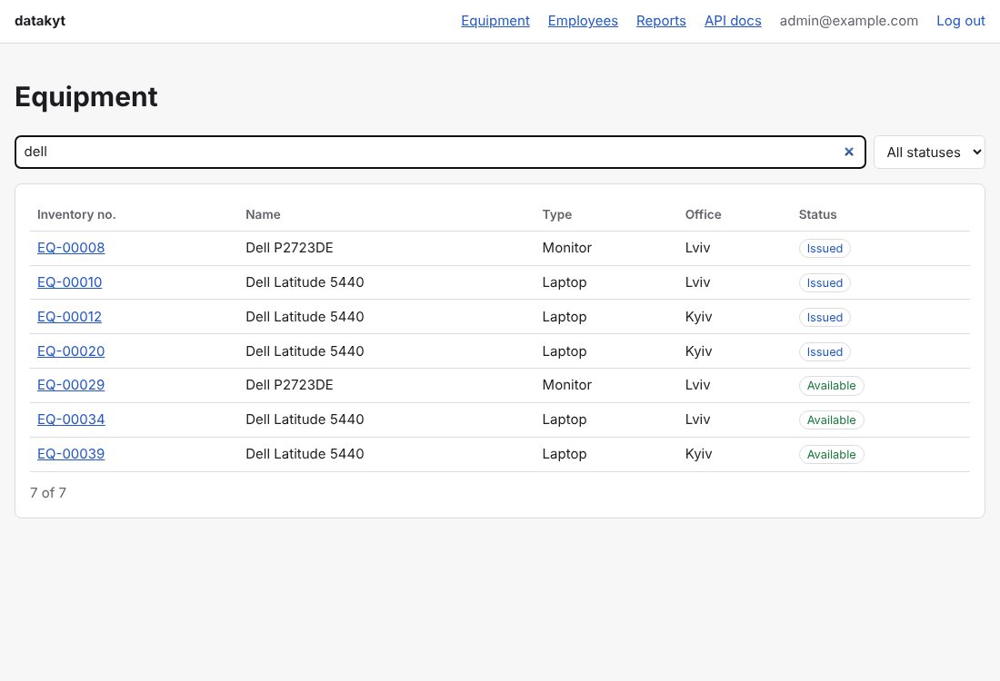

# datakyt
<!-- ALL-CONTRIBUTORS-BADGE:START - Do not remove or modify this section -->
[](#contributors-)
<!-- ALL-CONTRIBUTORS-BADGE:END -->
[](https://github.com/MykytaKyt/datakyt/actions/workflows/ci.yml)

datakyt keeps track of a company's equipment: who has which laptop, monitor,
chair or software license, what is in repair, and which warranties and licenses
run out soon. It is a FastAPI service with a PostgreSQL database, a small web UI,
printable QR inventory labels, CSV/XLSX import and export, reports, backups and
two roles (admin and read-only viewer).



## Quick start

Requirements: Docker with the Compose plugin.

```sh
git clone https://github.com/MykytaKyt/datakyt.git
cd datakyt
docker compose up
```

Open <http://localhost:8000>. On first start the app applies migrations, loads
demo data and creates the user `admin@example.com`. Its generated password is
printed once in the log:

```sh
docker compose logs app | grep "generated password"
```

To choose the password yourself, copy `.env.example` to `.env` and set
`DATAKYT_ADMIN_PASSWORD` before the first start.

- Web UI: <http://localhost:8000/ui/>
- Interactive API docs (OpenAPI): <http://localhost:8000/docs>
- Health check: <http://localhost:8000/health>
- A scripted tour of the API: [`examples/walkthrough.sh`](examples/walkthrough.sh)

## Features

| Area | What you get |
| --- | --- |
| Inventory | CRUD for employees, offices, projects, equipment (with parts), furniture, equipment and furniture types, software and licenses; search, filters, sorting and pagination on every list |
| Assignments | `POST /equipment/{id}/issue` and `/return` (same for furniture); an item can only be issued when available and never to two people at once; license seats and expiry are enforced |
| Reports | inventory by office/type/status, everything held by one employee, licenses and warranties expiring within N days; JSON, CSV or XLSX (`?format=`) |
| Import/export | `GET /export/{entity}.csv` or `.xlsx`; `POST /import/{entity}` with a dry run that reports errors per row before anything is written |
| Labels | `GET /equipment/{id}/label.png` and `GET /labels.pdf?ids=1,2,3` (A4, 3x8 grid); the QR code encodes `datakyt://equipment/<inventory number>` |
| Access | JWT bearer tokens (`POST /auth/login`); `admin` can change data, `viewer` can only read; every change is written to an audit log |
| Operations | `datakyt backup` / `restore`, structured JSON logs with request IDs, `/health` |

## Configuration

All settings are environment variables (or lines in `.env`); see
[`.env.example`](.env.example).

| Variable | Default | Purpose |
| --- | --- | --- |
| `DATAKYT_ENV` | `development` | `production` requires `DATAKYT_JWT_SECRET` |
| `DATAKYT_DB_HOST`, `_PORT`, `_NAME`, `_USER`, `_PASSWORD` | `localhost`, `5432`, `datakyt`, `datakyt`, empty | Database connection |
| `DATAKYT_DATABASE_URL` | unset | Full SQLAlchemy URL; overrides the `DB_*` values |
| `DATAKYT_JWT_SECRET` | random per process | Token signing key, at least 32 characters |
| `DATAKYT_JWT_TTL_MINUTES` | `480` | Token lifetime |
| `DATAKYT_ADMIN_EMAIL`, `DATAKYT_ADMIN_PASSWORD` | `admin@example.com`, generated | First admin created by `datakyt bootstrap` |
| `DATAKYT_SEED_DEMO` | `false` (`true` in Compose) | Load demo data on bootstrap if the database is empty |
| `DATAKYT_BACKUP_DIR`, `DATAKYT_BACKUP_KEEP` | `backups`, `7` | Backup location and retention |
| `DATAKYT_LOG_LEVEL` | `INFO` | Log level |

## Command line

```text
datakyt migrate            apply database migrations
datakyt bootstrap          create the first admin (and demo data if enabled)
datakyt serve              run the web server
datakyt create-user EMAIL  add a user (--role admin|viewer)
datakyt seed               load demo data into an empty database
datakyt backup             pg_dump into DATAKYT_BACKUP_DIR, keep the newest N
datakyt restore FILE       restore a dump made by `datakyt backup`
```

In Compose, run them with `docker compose exec app datakyt <command>`.

## Development

Requirements: Python 3.12, [uv](https://docs.astral.sh/uv/), and either Docker
(tests start PostgreSQL with testcontainers) or a PostgreSQL 16 server named by
`DATAKYT_TEST_DATABASE_URL`.

```sh
make install   # dependencies and git hooks
make lint      # ruff, formatting, mypy --strict, schema diagram check
make test      # pytest with coverage
make run       # dev server with auto-reload (needs a database, e.g. `docker compose up db`)
```

Schema changes go through Alembic migrations (`uv run alembic revision
--autogenerate -m "..."`); afterwards run `make erd` to regenerate
[`docs/diagram.md`](docs/diagram.md). Read [CONTRIBUTING.md](CONTRIBUTING.md)
before opening a pull request, and [SECURITY.md](SECURITY.md) to report a
vulnerability. The original requirements are in [docs/srs.md](docs/srs.md).

## Contributors ✨

Thanks goes to these wonderful people ([emoji key](https://allcontributors.org/docs/en/emoji-key)):

<!-- ALL-CONTRIBUTORS-LIST:START - Do not remove or modify this section -->
<!-- prettier-ignore-start -->
<!-- markdownlint-disable -->
<table>
  <tr>
    <td align="center"><a href="https://github.com/aartiukh"><br /><sub><b>Anton Artiukh</b></sub></a><br /><a href="#infra-aartiukh" title="Infrastructure (Hosting, Build-Tools, etc)">🚇</a> <a href="#talk-aartiukh" title="Talks">📢</a> <a href="https://github.com/MykytaKyt/datakyt/pulls?q=is%3Apr+reviewed-by%3Aaartiukh" title="Reviewed Pull Requests">👀</a></td>
    <td align="center"><a href="https://github.com/MykytaKyt"><br /><sub><b>Mykyta Kyt</b></sub></a><br /><a href="#talk-MykytaKyt" title="Talks">📢</a> <a href="#example-MykytaKyt" title="Examples">💡</a> <a href="#design-MykytaKyt" title="Design">🎨</a> <a href="https://github.com/MykytaKyt/datakyt/commits?author=MykytaKyt" title="Documentation">📖</a> <a href="https://github.com/MykytaKyt/datakyt/commits?author=MykytaKyt" title="Code">💻</a></td>
    <td align="center"><a href="https://github.com/OleksandrZhytnyk"><br /><sub><b>Oleksandr Zhytnyk</b></sub></a><br /><a href="https://github.com/MykytaKyt/datakyt/commits?author=OleksandrZhytnyk" title="Code">💻</a> <a href="https://github.com/MykytaKyt/datakyt/commits?author=OleksandrZhytnyk" title="Documentation">📖</a> <a href="#talk-OleksandrZhytnyk" title="Talks">📢</a></td>
    <td align="center"><a href="https://github.com/paulzcooper"><br /><sub><b>Polina Zemko</b></sub></a><br /><a href="#talk-paulzcooper" title="Talks">📢</a> <a href="https://github.com/MykytaKyt/datakyt/pulls?q=is%3Apr+reviewed-by%3Apaulzcooper" title="Reviewed Pull Requests">👀</a> <a href="https://github.com/MykytaKyt/datakyt/commits?author=paulzcooper" title="Code">💻</a> <a href="#ideas-paulzcooper" title="Ideas, Planning, & Feedback">🤔</a></td>
  </tr>
</table>

<!-- markdownlint-enable -->
<!-- prettier-ignore-end -->
<!-- ALL-CONTRIBUTORS-LIST:END -->

This project follows the [all-contributors](https://github.com/all-contributors/all-contributors) specification. Contributions of any kind welcome!
