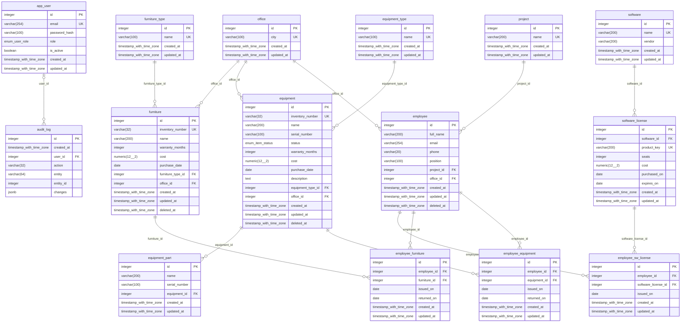

# Database schema

<!-- Generated by scripts/generate_erd.py from datakyt/models. Do not edit by hand;
     run `make erd` after changing the models. -->

## app_user

| column | type | null | keys | references |
| --- | --- | --- | --- | --- |
| id | integer | no | PK |  |
| email | varchar(254) | no | UK |  |
| password_hash | varchar(100) | no |  |  |
| role | enum user_role | no |  |  |
| is_active | boolean | no |  |  |
| created_at | timestamp with time zone | no |  |  |
| updated_at | timestamp with time zone | no |  |  |

## audit_log

| column | type | null | keys | references |
| --- | --- | --- | --- | --- |
| id | integer | no | PK |  |
| created_at | timestamp with time zone | no |  |  |
| user_id | integer | yes | FK | app_user.id (SET NULL) |
| action | varchar(32) | no |  |  |
| entity | varchar(64) | no |  |  |
| entity_id | integer | yes |  |  |
| changes | jsonb | no |  |  |

## employee

| column | type | null | keys | references |
| --- | --- | --- | --- | --- |
| id | integer | no | PK |  |
| full_name | varchar(200) | no |  |  |
| email | varchar(254) | no |  |  |
| phone | varchar(20) | yes |  |  |
| position | varchar(100) | yes |  |  |
| project_id | integer | no | FK | project.id (RESTRICT) |
| office_id | integer | no | FK | office.id (RESTRICT) |
| created_at | timestamp with time zone | no |  |  |
| updated_at | timestamp with time zone | no |  |  |
| deleted_at | timestamp with time zone | yes |  |  |

- unique (email) where deleted_at IS NULL
- unique (phone) where deleted_at IS NULL

## employee_equipment

| column | type | null | keys | references |
| --- | --- | --- | --- | --- |
| id | integer | no | PK |  |
| employee_id | integer | no | FK | employee.id (CASCADE) |
| equipment_id | integer | no | FK | equipment.id (CASCADE) |
| issued_on | date | no |  |  |
| returned_on | date | yes |  |  |
| created_at | timestamp with time zone | no |  |  |
| updated_at | timestamp with time zone | no |  |  |

- check: `returned_on IS NULL OR returned_on >= issued_on`
- unique (equipment_id) where returned_on IS NULL

## employee_furniture

| column | type | null | keys | references |
| --- | --- | --- | --- | --- |
| id | integer | no | PK |  |
| employee_id | integer | no | FK | employee.id (CASCADE) |
| furniture_id | integer | no | FK | furniture.id (CASCADE) |
| issued_on | date | no |  |  |
| returned_on | date | yes |  |  |
| created_at | timestamp with time zone | no |  |  |
| updated_at | timestamp with time zone | no |  |  |

- check: `returned_on IS NULL OR returned_on >= issued_on`
- unique (furniture_id) where returned_on IS NULL

## employee_sw_license

| column | type | null | keys | references |
| --- | --- | --- | --- | --- |
| id | integer | no | PK |  |
| employee_id | integer | no | FK | employee.id (CASCADE) |
| software_license_id | integer | no | FK | software_license.id (CASCADE) |
| issued_on | date | no |  |  |
| created_at | timestamp with time zone | no |  |  |
| updated_at | timestamp with time zone | no |  |  |

## equipment

| column | type | null | keys | references |
| --- | --- | --- | --- | --- |
| id | integer | no | PK |  |
| inventory_number | varchar(32) | no | UK |  |
| name | varchar(200) | no |  |  |
| serial_number | varchar(100) | no |  |  |
| status | enum item_status | no |  |  |
| warranty_months | integer | no |  |  |
| cost | numeric(12, 2) | no |  |  |
| purchase_date | date | no |  |  |
| description | text | yes |  |  |
| equipment_type_id | integer | no | FK | equipment_type.id (RESTRICT) |
| office_id | integer | no | FK | office.id (RESTRICT) |
| created_at | timestamp with time zone | no |  |  |
| updated_at | timestamp with time zone | no |  |  |
| deleted_at | timestamp with time zone | yes |  |  |

- check: `cost > 0`
- check: `warranty_months >= 0`

## equipment_part

| column | type | null | keys | references |
| --- | --- | --- | --- | --- |
| id | integer | no | PK |  |
| name | varchar(200) | no |  |  |
| serial_number | varchar(100) | yes |  |  |
| equipment_id | integer | no | FK | equipment.id (CASCADE) |
| created_at | timestamp with time zone | no |  |  |
| updated_at | timestamp with time zone | no |  |  |

## equipment_type

| column | type | null | keys | references |
| --- | --- | --- | --- | --- |
| id | integer | no | PK |  |
| name | varchar(100) | no | UK |  |
| created_at | timestamp with time zone | no |  |  |
| updated_at | timestamp with time zone | no |  |  |

## furniture

| column | type | null | keys | references |
| --- | --- | --- | --- | --- |
| id | integer | no | PK |  |
| inventory_number | varchar(32) | no | UK |  |
| name | varchar(200) | no |  |  |
| warranty_months | integer | no |  |  |
| cost | numeric(12, 2) | no |  |  |
| purchase_date | date | no |  |  |
| furniture_type_id | integer | no | FK | furniture_type.id (RESTRICT) |
| office_id | integer | no | FK | office.id (RESTRICT) |
| created_at | timestamp with time zone | no |  |  |
| updated_at | timestamp with time zone | no |  |  |
| deleted_at | timestamp with time zone | yes |  |  |

- check: `cost > 0`
- check: `warranty_months >= 0`

## furniture_type

| column | type | null | keys | references |
| --- | --- | --- | --- | --- |
| id | integer | no | PK |  |
| name | varchar(100) | no | UK |  |
| created_at | timestamp with time zone | no |  |  |
| updated_at | timestamp with time zone | no |  |  |

## office

| column | type | null | keys | references |
| --- | --- | --- | --- | --- |
| id | integer | no | PK |  |
| city | varchar(100) | no | UK |  |
| created_at | timestamp with time zone | no |  |  |
| updated_at | timestamp with time zone | no |  |  |

## project

| column | type | null | keys | references |
| --- | --- | --- | --- | --- |
| id | integer | no | PK |  |
| name | varchar(200) | no | UK |  |
| created_at | timestamp with time zone | no |  |  |
| updated_at | timestamp with time zone | no |  |  |

## software

| column | type | null | keys | references |
| --- | --- | --- | --- | --- |
| id | integer | no | PK |  |
| name | varchar(200) | no | UK |  |
| vendor | varchar(200) | yes |  |  |
| created_at | timestamp with time zone | no |  |  |
| updated_at | timestamp with time zone | no |  |  |

## software_license

| column | type | null | keys | references |
| --- | --- | --- | --- | --- |
| id | integer | no | PK |  |
| software_id | integer | no | FK | software.id (RESTRICT) |
| product_key | varchar(200) | yes | UK |  |
| seats | integer | no |  |  |
| cost | numeric(12, 2) | yes |  |  |
| purchased_on | date | no |  |  |
| expires_on | date | yes |  |  |
| created_at | timestamp with time zone | no |  |  |
| updated_at | timestamp with time zone | no |  |  |

- check: `cost IS NULL OR cost >= 0`
- check: `expires_on IS NULL OR expires_on >= purchased_on`
- check: `seats > 0`
